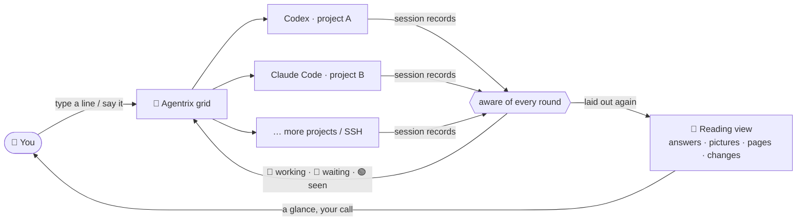

<p align="center">
  <a href="https://github.com/noeigenstate/Agentrix/releases/latest"></a>
</p>

<p align="center"><strong>AI development as a closed loop, from goal to delivery: you say what you want, AI does the work, comes to you when a decision is yours, and hands the result over for review.</strong></p>
<p align="center">Codex and Claude Code work on many projects at once; Agentrix gathers what needs your call in one place and puts what they made in front of you.</p>

<p align="center">
  <a href="https://github.com/noeigenstate/Agentrix/releases/latest"></a>
  <a href="https://github.com/noeigenstate/Agentrix/releases"></a>
  
  <a href="LICENSE"></a>
</p>

<p align="center">
  <a href="https://github.com/noeigenstate/Agentrix/releases/latest"><strong>⬇️ Download</strong></a> ·
  <a href="#-at-a-glance">At a glance</a> ·
  <a href="#-how-it-works">How it works</a> ·
  <a href="#-highlights">Highlights</a> ·
  <a href="#-get-started">Get started</a> ·
  <a href="README.zh-CN.md">中文</a>
</p>

<p align="center">
  
</p>
<p align="center"><sub>30-second film · <a href="docs/images/promo.mp4">full quality</a></sub></p>

## ✨ At a glance

<table>
  <tr>
    <td width="33%" valign="top"><h3>🧭 Decide first</h3>Everything across your projects that needs your call on one page: approvals, questions, choices, sign-ins, rounds to review. Permission cards open the source terminal for confirmation; other answers go only when you confirm them.</td>
    <td width="33%" valign="top"><h3>🧩 Many at once</h3>Every project is a card with a real terminal. Codex and Claude Code work at the same time: 🔵 working, 🩷 done and waiting, 🟢 seen, one alert per round.</td>
    <td width="33%" valign="top"><h3>📖 Terminal as a timeline</h3>The conversation as a timeline: each prompt, answer and group of tool calls a node; pictures, pages and videos show right in the answer.</td>
  </tr>
  <tr>
    <td valign="top"><h3>📊 Usage at a glance</h3>The activity pane shows the model route, how much context is left and the 5-hour and weekly limits; Codex can reset its limits after a 10-second countdown you can cancel.</td>
    <td valign="top"><h3>✅ Keep what matters</h3>Review changes hunk by hunk the way Git shows them: keep what you want, revert the rest, no <code>git add -p</code> to remember.</td>
    <td valign="top"><h3>🎙️ Just say it</h3><kbd>Ctrl</kbd>+<kbd>T</kbd>, talk, Enter. Recognition runs offline on your machine; audio never leaves it.</td>
  </tr>
</table>

## 🔭 The next editor

For forty years editors were built around **a file and a cursor**. Now that AI writes the code, what you really manage are **tasks and agents**: which one is thinking, which one is done, which one is stuck waiting for you, and what exactly it changed.

**1.0 changes direction**: Agentrix is no longer just a window full of terminals but a complete development loop — **set a goal → AI works in parallel → decisions come to you in one place → the results are put in front of you → keep what you want and ship it**. You own the goals and the judgment; the execution goes to AI.

| | A few terminals in an IDE | Agentrix |
| --- | --- | --- |
| **Several projects at once** | Switch windows, keep it all in your head | One grid, every state at a glance |
| **Is it done?** | Watch the terminal until it goes quiet | Read from its session records; it lights up and notifies you |
| **What did it say?** | Box art in a terminal | A laid-out document, with its pictures and pages shown |
| **What did it change?** | Run `git diff` yourself | Hunk by hunk, kept or reverted in one click |
| **Telling it what to do** | Type | Type, or just say it |

The terminals still run your own `codex` and `claude`, with the keys, settings and behaviour you already know.

## 🧠 How it works



## 🚀 Highlights

### 🧭 Decide first, then dive in


Agentrix opens on **Decide**: everything across your projects that needs your call, as a stack of cards — approvals, questions, choices, sign-ins, and rounds of work handed in for review — each titled by what it would do ("Run a command: ./cleanup-archive.ps1 …") with the command itself. Permission cards show the request and open its source terminal for confirmation; other answers are sent only when you confirm them. You can put it off or open the source. A column beside it shows what every session is doing and waiting on, and the box below tells Agentrix what to do next (paste a screenshot into it too). Decide · Workbench in the title bar switch at any time: the workbench is the project grid.

**Native approvals (opt-in):** Select **Native approvals** in the new-session launcher. Codex keeps its real TUI through an owned, authenticated loopback app-server connection (experimental remote transport). Reading and Decide show requests issued on that connection and respond with the original typed JSON-RPC request ID. Command and file approvals offer Allow once, Deny and Cancel turn when supported; permission requests grant exactly the requested permissions for the current turn or deny them. Session-wide grants and policy amendments are unavailable from cards.

**Claude SDK (managed)** is an explicit structured conversation mode with its own Reading composer and CLI-issued tool approval IDs. Allow returns the original tool input; Deny rejects the tool. It does not provide Claude's interactive TUI, slash-command menus, image attachments or resume. Existing user permission settings and hooks remain in force; Agentrix does not install a blanket tool-allow hook. Ordinary Claude TUI sessions remain available through the standard launch modes.

**Legacy and SSH permissions remain terminal-only:** Screen-derived cards only open the source terminal. The old approval IPC never sends PTY approval keys, even with a fabricated ID. Manual terminals, SSH, ordinary menus and sign-in retain their existing behavior. Unknown Codex requests are handled in the real TUI; unsupported Claude control requests stop the managed channel. Native mode currently starts fresh sessions only and does not automatically restore/reconnect them. Transport errors, malformed streams, reused IDs, a 10-minute approval timeout, or limits (256 KiB per record, 64 pending approvals, 8192 issued IDs per connection) revoke pending cards and close that owned session; there is no automatic approval retry or PTY fallback. Choose a standard terminal session when native transport is unavailable.

### 🧩 Direct every project from one screen


- 🔵 **Blue edge**: working, leave it be
- ⚪ **Breathing white glow, a notification**: all work is done and waiting for you
- ✓ **No glow or edge**: seen, marked “Round complete”, ready for the next instruction
- 🔴 **Red edge**: an error; check the terminal output

The white glow fades inward from the edges about every 2.5 seconds until viewed, with no outline. Viewing the card or sending a new instruction in its terminal clears the glow. A project in focus mode draws no edge.

State comes from the rounds Codex and Claude Code record themselves, not from guessing how long the terminal has been quiet: the card waits for the main round, every background subagent and command it started, queued messages and work in every other project terminal to finish. One step or subagent finishing alone doesn't count, and each instruction alerts once. Drag cards to reorder, expand one from its header and shrink it back without losing the session or an unsent draft, and split a project into several terminals.

### 📖 The terminal, laid out again


Switch any Claude Code or Codex conversation to the **reading view**: a timeline where your prompts, its answers and each group of tool calls are nodes on a line, each time after the name ("You 18:39"), the avatars, cards and message box in one column with equal margins left and right. The nodes are hollow rings in the colour of who is speaking (blue you, an orange spark Claude, white Codex, cyan a step), and a running one never spins: Claude's spark blooms and draws back like its own ✻, other steps send out soft rings. Headings, lists, tables and code blocks with a Copy button sit on frosted cards, tool calls fold into a pill naming the files they changed, and an item hops when the pointer passes over it. The box at the bottom writes straight into the real terminal underneath, and the terminal is one click away.

- **What it made is in the answer.** Pictures, web pages, videos and Markdown an agent writes or names appear under its answer; a click opens the full picture, page or document in a popup over the current view (Esc closes it), never jumping into the project page or another program. Agentrix tells the agents so when it starts them, so they show you an image instead of saying a terminal can only show text.
- **The real CLI is a popup away.** Sending a slash command or `!` shell command opens the same live terminal over the reading view. Work in it directly; Esc stays with the CLI, and the close button or backdrop returns to reading without closing the CLI’s dialog. Type `/` for every command, `@` to mention a project file; `/resume` keeps the local session picker.
- **Questions and confirmations become cards.** Permission prompts become informative cards with an Open terminal action; pickers like `/model` and questions from Claude Code (AskUserQuestion) and Codex (Plan mode) remain interactive cards; what the agent is doing is written at the end of the conversation, as in its CLI, with a timer and Esc to interrupt.
- **Keep talking while it works.** A message sent mid-round is marked *delivered and queued*: the agent reads it once the current step is done, and it is never sent twice or taken for undelivered.

The **activity pane** starts with the model route (agent › service › model, with the reasoning effort and speed mode, and every model it calls on its behalf, such as Sonnet 5.5 subagents or Codex GPT-6.1-Sol runs, with counts for preparing, running and reviewing calls; each call disappears when its review round ends), the context length (used / window) and usage: tokens this round and this conversation, and the 5-hour and weekly limits (Codex's from its session records, Claude Code's from its own cached `/usage`, or CodePulse's record when that is fresher). Codex also shows when each limit resets. Running and queued tasks are last, at the bottom of the pane.

The Codex usage card has a **Reset limit** button: a click starts a 10-second countdown that *Cancel* or Esc stops at any time; only then does Codex open `/usage`, where you pick a reset and confirm. Agentrix itself never calls a reset. Supported local official Codex accounts supply the remaining reset count through a separate read-only app-server query. Local wrappers check the complete launch arguments: flag-free launches, `resume`, `-m`/`--model` and `-c`/`--config` overrides limited to `model`, `model_reasoning_effort` and `service_tier` (including fast mode) are supported. Unproven profiles, account/provider overrides, relevant environment overrides and home changes remain explicitly unavailable. Unknown, failed and unsupported reads stay distinct from zero. Remote, custom-provider and ambiguous launch scopes never borrow the local account’s count.

> The reading view currently supports **Claude Code** and **Codex**. OpenCode, Gemini CLI and other command-line agents run as usual in the card's terminal.

### ✅ Keep only what matters


When a round ends, open a changed file from the Git tab and see it the way `git diff` does. **Decide each hunk on its own**: keep it (stage it) or revert it; unstage what you staged, bring back a deleted file.

### 🎙️ Speak, and it listens


Press <kbd>Ctrl</kbd>+<kbd>T</kbd> and talk to the current terminal; Enter sends. Recognition runs offline on your machine, **audio never leaves it**, and no API key is needed; a high-accuracy model for mixed Chinese and English is available.

### 🔑 From install to sign-in, all in the window

- **Nothing installed yet?** A new project's card marks an agent that is missing; one click installs it and starts it, and without Node.js it takes you to the download first.
- **A first start that never gets stuck:** trusting a folder or picking a sign-in method and update offers are popups; signing in opens a *Sign in to Claude Code / Codex* window to open the sign-in page in your browser, paste the code or API key, or copy a one-time code. The code goes to the CLI only and never appears in the conversation or the task list.

### And also

- **Pick up where you left off**: terminals and Codex / Claude Code sessions come back on start, and an interrupted task carries on.
- **SSH projects**: reuse your VS Code Remote-SSH hosts; terminals, files, Git and previews all run over SSH, and pages and pictures made on a machine on your network preview too.
- **Files at hand**: a folder tree, an auto-saving editor (VS Code's editing keys, <kbd>Ctrl</kbd>+<kbd>F</kbd> to find), previews of images, web pages, video and Markdown, and a right-click to open a file's location; <kbd>Ctrl</kbd>+click (<kbd>⌘</kbd>+click on macOS) a path in the terminal to open it in a popup; an enlarged picture fits the window, a click shows it at its own size to drag around.
- **Splits you drag**: several terminals for one project side by side, with dividers you drag to resize.
- **Clear to read**: dark frosted glass with white text over a wallpaper at its own brightness; switch to the **solid** surface for the sharpest text. The appearance is fixed to **Island Dusk (Catalina)**; glass transparency, font size and terminal fonts remain adjustable.
- **Project thumbnails**: automatically pick a local project image and keep it fixed; change it or restore numbered cards in [Appearance settings](docs/project-images.md).
- **English and Chinese, remappable shortcuts, automatic updates on Windows**, and a guided tour the first time you open it.

## 📦 Get started

New installs default to English. Choose 中文 under **Settings → Appearance → Language** to switch to Chinese; existing language preferences are kept.

**You need:** Windows 10 / 11 x64, an Apple silicon Mac (macOS 12 or later), or a 64-bit Linux desktop (x64 / arm64). [Codex CLI](https://github.com/openai/codex) or [Claude Code](https://docs.anthropic.com/claude-code) can be installed with one click from a project's card.

1. **Install** the build for your system from [Releases](https://github.com/noeigenstate/Agentrix/releases/latest) (below).
2. **Add projects** with <kbd>Ctrl</kbd>+<kbd>Shift</kbd>+<kbd>N</kbd>: pick one or more folders, or an SSH project.
3. **Give instructions**: pick Claude Code or Codex on the card, continuing this folder's last conversation or starting fresh; the first time, a popup walks you through signing in. Say what to do and get on with something else. Come back when its white glow pulses.

| System | Download | Notes |
| --- | --- | --- |
| **Windows** | `Agentrix-Setup-<version>-x64.exe` | Updates itself |
| **macOS** | Run the command below in Terminal | The same command installs and updates; the app is signed ad hoc, not notarized |
| **Linux** | `Agentrix-<version>-linux-<arch>.AppImage` | `chmod +x` and run; a `.tar.xz` is also available |

```bash
curl -fsSL https://raw.githubusercontent.com/noeigenstate/Agentrix/main/scripts/install-macos.sh | bash
```

A specific version, manual installs, and terminal and shortcut details for macOS and Linux are in the [usage guide](docs/usage.md#安装细节) (Chinese).

<details>
<summary><strong>⌨️ Shortcuts</strong> (all remappable in Settings; macOS also uses Control)</summary>

| Shortcut | Action |
| --- | --- |
| <kbd>Ctrl</kbd>+<kbd>Shift</kbd>+<kbd>N</kbd> | Add projects |
| <kbd>Ctrl</kbd>+<kbd>Shift</kbd>+<kbd>Enter</kbd> | Expand or restore the current project |
| <kbd>Ctrl</kbd>+<kbd>Shift</kbd>+<kbd>G</kbd> | Back to the overview |
| <kbd>Ctrl</kbd>+<kbd>Tab</kbd> / <kbd>Ctrl</kbd>+<kbd>Shift</kbd>+<kbd>Tab</kbd> | Next / previous project |
| <kbd>Ctrl</kbd>+<kbd>Shift</kbd>+<kbd>T</kbd> | New terminal in the current project, split |
| <kbd>Ctrl</kbd>+<kbd>Shift</kbd>+<kbd>W</kbd> | Remove the current project (its files stay) |
| <kbd>Ctrl</kbd>+<kbd>T</kbd> | Voice input; Enter sends, Esc cancels |
| <kbd>Ctrl</kbd>+<kbd>Shift</kbd>+<kbd>F</kbd> | Search projects |
| <kbd>Ctrl</kbd>+<kbd>B</kbd> | Show or hide the folder sidebar |
| <kbd>F11</kbd> | Full screen |
| <kbd>Ctrl</kbd>+<kbd>,</kbd> | Settings |

</details>

## ❓ FAQ

<details>
<summary><strong>Is my code or data uploaded?</strong></summary>

Agentrix itself **collects nothing and sends no analytics**. It only contacts GitHub (update checks) and Hugging Face or its mirror (the first download of the offline speech recognition model). Codex and Claude Code talk to their own services exactly as they do in any terminal.

</details>

<details>
<summary><strong>How is this different from a few terminals in an IDE?</strong></summary>

The terminals are the same; the difference is that Agentrix **knows what state each agent is in**. It reads the session records of Codex and Claude Code to tell working, done and interrupted apart, and lays answers, command results, pictures, pages and changes out for you to read. It is designed for directing several AI tasks at once, not for one person editing one file.

</details>

<details>
<summary><strong>Does Reset limit reset anything by itself?</strong></summary>

No. A Codex reset spends one of the plan's few, so the button first counts down 10 seconds that you can cancel at any time; even then it only opens Codex's `/usage`, where you choose and confirm the reset. Agentrix calls no reset service and never sends that command unless you clicked.

</details>

<details>
<summary><strong>Does it change my Codex / Claude Code configuration?</strong></summary>

No. The hooks for completion alerts and the note that the reading view shows pictures are passed in at launch and never written to your configuration; your own hooks, settings and instructions keep working, and the same options given on your own command line win.

</details>

## 🗺️ Roadmap

- [ ] A side panel listing each requirement and bug with its status and fix attempts
- [ ] A development overview: tokens, cost and time for each requirement and bug
- [ ] The reading view for more CLIs (OpenCode, Gemini CLI and others)
- [ ] WSL workspaces

Ideas are welcome as [issues](https://github.com/noeigenstate/Agentrix/issues). If it helps you, a ⭐ helps others find it.

## 🛠️ Development

```bash
git clone https://github.com/noeigenstate/Agentrix.git
cd Agentrix
npm ci
npm start              # run in development
npm test               # unit tests
npm run test:desktop   # real desktop interaction tests
npm run dist           # Windows installer (dist:mac on macOS, dist:linux on Linux)
```

Electron · React · TypeScript · xterm.js · node-pty. Every release passes the unit tests, packaged desktop tests and a Linux SSH integration test first. Screenshots come from `scripts/readme-shots.mjs` on demonstration projects; the film is rendered frame by frame from `scripts/promo/`.

## 📄 License

[MIT](LICENSE).

---

<p align="center">
  <strong>Let AI do the work. Keep your attention for where it is needed.</strong><br />
  <a href="https://github.com/noeigenstate/Agentrix/releases/latest">Download</a> ·
  <a href="https://github.com/noeigenstate/Agentrix/issues">Feedback</a>
</p>
