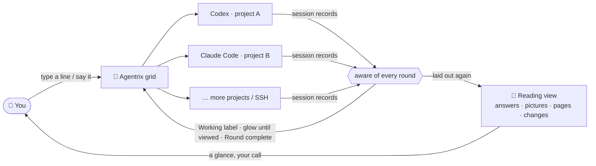

<p align="center">
  <a href="https://github.com/noeigenstate/Agentrix/releases/latest"></a>
</p>

<p align="center"><strong>AI development as a closed loop, from goal to delivery: you say what you want, AI does the work, comes to you when a decision is yours, and hands the result over for review.</strong></p>
<p align="center">Codex and Claude Code work on many projects at once; Agentrix gathers what needs your call in one place and puts what they made in front of you.</p>

<p align="center">
  <a href="https://github.com/noeigenstate/Agentrix/releases/latest"></a>
  <a href="https://github.com/noeigenstate/Agentrix/releases"></a>
  
  <a href="LICENSE"></a>
</p>

<p align="center">
  <a href="https://github.com/noeigenstate/Agentrix/releases/latest"><strong>⬇️ Download</strong></a> ·
  <a href="#-at-a-glance">At a glance</a> ·
  <a href="#-how-it-works">How it works</a> ·
  <a href="#-highlights">Highlights</a> ·
  <a href="#-get-started">Get started</a> ·
  <a href="README.zh-CN.md">中文</a>
</p>

<p align="center">
  
</p>
<p align="center"><sub>30-second film · <a href="docs/images/promo.mp4">full quality</a></sub></p>

## ✨ At a glance

<table>
  <tr>
    <td width="33%" valign="top"><h3>🧭 Decide first</h3>Approvals, questions, choices, sign-ins and rounds to review on one page. Screen-derived permission cards open the source terminal; supported questions and choices have their own answer controls.</td>
    <td width="33%" valign="top"><h3>🧩 Many at once</h3>Grid cards show Codex and Claude Code sessions. A Working label and dot show activity; an inward breathing glow marks work waiting for review. One completion alert per instruction.</td>
    <td width="33%" valign="top"><h3>📖 Read the conversation</h3>A centred chat column: your messages on the right, the agent on the left, commands in collapsible groups. Pictures, pages and videos appear with the answer.</td>
  </tr>
  <tr>
    <td valign="top"><h3>📊 Usage at a glance</h3>The activity pane shows the main model and subagents with live token/s, context and automatically updated 5-hour and weekly limits. Reset limit opens Codex's own <code>/usage</code> after a cancellable 10-second countdown; you confirm the reset there.</td>
    <td valign="top"><h3>✅ Keep what matters</h3>Review changes hunk by hunk the way Git shows them: keep what you want, revert the rest, no <code>git add -p</code> to remember.</td>
    <td valign="top"><h3>🎙️ Just say it</h3><kbd>Ctrl</kbd>+<kbd>T</kbd>, talk, Enter. Recognition runs offline on your machine; audio never leaves it.</td>
  </tr>
</table>

## 🔭 The next editor

For forty years editors were built around **a file and a cursor**. Now that AI writes the code, what you really manage are **tasks and agents**: which one is thinking, which one is done, which one is stuck waiting for you, and what exactly it changed.

**1.0 changes direction**: Agentrix is no longer just a window full of terminals but a complete development loop — **set a goal → AI works in parallel → decisions come to you in one place → the results are put in front of you → keep what you want and ship it**. You own the goals and the judgment; the execution goes to AI.

| | A few terminals in an IDE | Agentrix |
| --- | --- | --- |
| **Several projects at once** | Switch windows, keep it all in your head | One grid, every state at a glance |
| **Is it done?** | Watch the terminal until it goes quiet | Read from its session records; it lights up and notifies you |
| **What did it say?** | Box art in a terminal | A laid-out document, with its pictures and pages shown |
| **What did it change?** | Run `git diff` yourself | Hunk by hunk, kept or reverted in one click |
| **Telling it what to do** | Type | Type, or just say it |

The terminals still run your own `codex` and `claude`, with the keys, settings and behaviour you already know.

## 🧠 How it works



## 🚀 Highlights

### 🧭 Decide first, then dive in


Agentrix opens on **Decide** by default. Select a project from the session list; when no decision is selected, a centred new-task composer shows above a short summary of that session's recent round. Type a goal, paste a screenshot or dictate, then press Enter to start. It sends to the running agent or starts the chosen local agent first; an SSH agent must already be running. The summary's Open session action opens the project. Decide · Workbench in the title bar switch at any time; Workbench is the project grid.

Select a decision to see its request and source. Screen-derived permission cards open the terminal for approval; choice cards confirm the selected answer, and question cards use the CLI's answer controls. You can open the source or put a request off while execution waits. Review cards show the round's reply, files and recorded checks: Pass acknowledges that round, and Send back with notes sends your feedback as the next instruction. Passing does not commit, merge or push changes.

**Native approvals (opt-in):** Select **Native approvals** in the new-session launcher. Codex keeps its real TUI through an owned, authenticated loopback app-server connection (experimental remote transport). Reading and Decide show requests issued on that connection and respond with the original typed JSON-RPC request ID. Command and file approvals offer Allow once, Deny and Cancel turn when supported; permission requests grant exactly the requested permissions for the current turn or deny them. Session-wide grants and policy amendments are unavailable from cards.

**Claude SDK (managed)** is an explicit structured conversation mode with its own Reading composer and CLI-issued tool approval IDs. Allow returns the original tool input; Deny rejects the tool. It does not provide Claude's interactive TUI, slash-command menus, image attachments or resume. Existing user permission settings and hooks remain in force; Agentrix does not install a blanket tool-allow hook. Ordinary Claude TUI sessions remain available through the standard launch modes.

**Legacy and SSH permissions remain terminal-only:** Screen-derived cards only open the source terminal. The old approval IPC never sends PTY approval keys, even with a fabricated ID. Manual terminals, SSH, ordinary menus and sign-in retain their existing behavior. Unknown Codex requests are handled in the real TUI; unsupported Claude control requests stop the managed channel. Native mode currently starts fresh sessions only and does not automatically restore/reconnect them. Transport errors, malformed streams, reused IDs, a 10-minute approval timeout, or limits (256 KiB per record, 64 pending approvals, 8192 issued IDs per connection) revoke pending cards and close that owned session; there is no automatic approval retry or PTY fallback. Choose a standard terminal session when native transport is unavailable.

### 🧩 Direct every project from one screen


Workbench cards show only terminals running Codex or Claude Code. Plain shells keep running and appear when you expand the project. Without an agent, a local card shows the launcher and an SSH card shows its empty state; if shells are running, **N terminals running · Click to expand** opens them.

- ● **Working label and dot in the header**: work is in progress, with no coloured card edge
- ⚪ **Inward breathing glow and a notification**: the round's work has finished and awaits your review
- ✓ **No glow or edge**: seen, marked “Round complete”, ready for the next instruction
- 🔴 **Red edge**: an error; check the terminal output

The glow is white in the dark theme and dark in the light theme. It fades inward from the edges about every 2.5 seconds until viewed, with no coloured completion border. Opening the project or sending a new instruction in its terminal clears it. A project in focus mode draws no state edge.

State comes from the rounds Codex and Claude Code record themselves: the card waits for the main round, tracked background subagents and commands, queued messages and other active agent terminals in the project to finish. Persistent servers and watchers do not count as pending work. One step finishing alone does not count. The same round will not alert again without a new instruction.

Drag cards by their headers to reorder. The header, waiting-status action or explicit expand action opens a project inside the current window; F11 controls native full screen separately. Typing, selecting and copying inside a small terminal keep the card small. Shrinking a project preserves its session and unsent draft; one project can hold several terminal splits.

### 📖 The terminal, laid out again


In an expanded project, use **Terminal | Reading** in the title bar to switch a Claude Code or Codex conversation to the **reading view**: a centred chat column with equal side margins, your messages on the right and the agent's replies on the left. Your avatar and the official agent logos fill their timeline nodes without decorative coloured rings. Replies support headings, lists, tables and code blocks with a Copy button. Commands and tool calls fold into groups with summaries and changed-file names. The latest finished round shows its status above the result. Code results show the checks run, without a changed-file list. Relevant actions appear below: open a file, view or save a picture, copy an answer, continue or retry. Saving a generated picture is unavailable over SSH; retry is available only when the agent can accept a new prompt. The box at the bottom sends to the same session.

- **What it made is in the answer.** Supported pictures, web pages, videos and Markdown an agent writes or names appear with its answer; an ordinary click opens the preview in a popup over the current view (Esc closes it). Generated pictures show a two-line prompt summary that you can expand.
- **Reveal a path.** In Reading, Ctrl+click a local file path (Command+click on macOS) to select the file in the system file manager; directories open there. Relative paths use the project root; existing absolute paths can be outside it. Missing paths report an error; SSH paths cannot be revealed locally. Ordinary links and previews for supported files stay in-app.
- **The real CLI is a popup away.** Sending a slash command or `!` shell command opens the same live terminal over the reading view. Work in it directly; Esc stays with the CLI, and the close button or backdrop returns to reading without closing the CLI’s dialog. Type `/` for every command, `@` to mention a project file; `/resume` keeps the local session picker.
- **Questions and confirmations become cards.** Permission prompts become informative cards with an Open terminal action; pickers like `/model` and questions from Claude Code (AskUserQuestion) and Codex (Plan mode) remain interactive cards; what the agent is doing is written at the end of the conversation, as in its CLI, with a timer and Esc to interrupt.
- **Keep talking while it works.** A message sent mid-round is marked *delivered and queued*: the agent reads it once the current step is done, and it is never sent twice or taken for undelivered. Claude's automatic continuation after a usage reset does not appear as your queued message.

The **activity pane** starts with the **main model**: the model its latest reply came from, its service, reasoning effort and speed mode, its average output speed in token/s, and its running and queued tasks (one line each with their elapsed time, the step it is on right now under the working one, and *Done* once the round ends). Called models follow, each group tagged Subagent with its own token/s, grouped by the model the worker actually ran (such as Sonnet 5.5 subagents or Codex GPT-6.1-Sol runs) with compact one-line calls marked Preparing, Running or Reviewing; a rate is the output tokens of finished replies over the time they took, updated as each reply lands, and shows a dash where the records can't be read (SSH projects); each call disappears when its review round ends. The main model's tasks and the called models each scroll within their own area. Below are aligned meters for context length, the 5-hour limit and the weekly limit, then one-line **This round** and **This conversation** token breakdowns for input, cache hits and output. There is no Usage heading or column of token totals. Limits update automatically from the latest Codex records. While a Claude terminal runs, Agentrix queries the Claude account's limits directly (at most once a minute, typing nothing into any terminal), falling back to Claude Code's cached `/usage` or CodePulse's record when that is fresher. Each limit shows its reset time when known.

Codex's **Reset limit** row shows the remaining reset count or query status inline. Clicking it opens a large, centred 10-second countdown; *Cancel*, Esc or a click outside cancels it. At zero, Codex's own `/usage` opens, where you pick a reset and confirm. Agentrix itself never calls a reset. Supported local official Codex accounts supply the remaining reset count through a separate read-only app-server query. Local wrappers check the complete launch arguments: flag-free launches, `resume`, `-m`/`--model` and `-c`/`--config` overrides limited to `model`, `model_reasoning_effort` and `service_tier` (including fast mode) are supported. Unproven profiles, account/provider overrides, relevant environment overrides and home changes remain explicitly unavailable. Unknown, failed and unsupported reads stay distinct from zero. Remote, custom-provider and ambiguous launch scopes never borrow the local account’s count.

> The reading view currently supports **Claude Code** and **Codex**. OpenCode, Gemini CLI and other command-line agents run as usual in an expanded project's terminals.

### ✅ Keep only what matters


When a round ends, open a changed file from the Git tab and see it the way `git diff` does. **Decide each hunk on its own**: keep it (stage it) or revert it; unstage what you staged, bring back a deleted file.

### 🎙️ Speak, and it listens


Choose **Voice input** in the project's **⋯** menu to talk to the selected terminal split, or press <kbd>Ctrl</kbd>+<kbd>T</kbd>; Enter sends. Recognition runs offline on your machine, **audio never leaves it**, and no API key is needed; a high-accuracy model for mixed Chinese and English is available.

In the Decide composer or review feedback box, Enter inserts the recognised words so you can review them before sending.

### 🔑 From install to sign-in, all in the window

- **Nothing installed yet?** A new project's card marks an agent that is missing; one click installs it and starts it, and without Node.js it takes you to the download first.
- **A first start that never gets stuck:** trusting a folder or picking a sign-in method and update offers are popups; signing in opens a *Sign in to Claude Code / Codex* window to open the sign-in page in your browser, paste the code or API key, or copy a one-time code. The code goes to the CLI only and never appears in the conversation or the task list.

### And also

- **Pick up where you left off**: terminals and Codex / Claude Code sessions come back on start, and an interrupted task carries on.
- **SSH projects**: reuse your VS Code Remote-SSH hosts; terminals, files, Git and previews all run over SSH, and pages and pictures made on a machine on your network preview too.
- **Files at hand**: a compact folder tree with dimmed, hideable cache files, an auto-saving editor (VS Code's editing keys, <kbd>Ctrl</kbd>+<kbd>F</kbd> to find), and image, web page, video and Markdown previews. A local file's context menu reveals its location. In the terminal, <kbd>Ctrl</kbd>+click (<kbd>⌘</kbd>+click on macOS) a supported project file link for a popup preview; HTTP/HTTPS links open in the browser and recognised local directory links open in the file manager. SSH files preview within the remote project; remote directory links open an in-app folder view. Missing or unsupported files show a message. An enlarged picture fits the window; click for its original size and drag to pan.
- **Splits you drag**: several terminals for one project side by side, with no header or footer bars. Hover or keyboard focus reveals a drag grip, restart and close in the top-right corner; use the grip to reorder splits.
- **Clear to read**: choose **Black and white** (dark, default) or **Black on white** (light) in Settings → Appearance. Both use solid grayscale surfaces, with no wallpaper picker. Font size, terminal fonts and text weight remain adjustable.
- **Project thumbnails**: automatically pick a local project image and keep it fixed; change it or restore numbered cards in [Appearance settings](docs/project-images.md).
- **Version and updates in Settings**: Updates and about identifies the version and build (installed, portable, development, macOS or Linux), and shows the current update state with the available check, retry, download-page or restart-and-install action. Changelog and About have their own pages. The title bar uses the app's four-square logo and a stamp icon for Decide.
- **English and Chinese, remappable shortcuts, updates for installed Windows copies**, and a guided tour the first time you open it.

## 📦 Get started

New installs default to English. Choose 中文 under **Settings → Appearance → Language** to switch to Chinese; existing language preferences are kept.

**You need:** Windows 10 / 11 x64, an Apple silicon Mac (macOS 12 or later), or a 64-bit Linux desktop (x64 / arm64). Install [Codex CLI](https://github.com/openai/codex) or [Claude Code](https://docs.anthropic.com/claude-code) and make it available on PATH. The local one-click installer needs Node.js and npm; it links to the Node.js download if npm is missing. Sign in to the agent before submitting work.

1. **Install** the build for your system from [Releases](https://github.com/noeigenstate/Agentrix/releases/latest) (below).
2. **Add projects** with <kbd>Ctrl</kbd>+<kbd>Shift</kbd>+<kbd>N</kbd>: pick one or more folders, or an SSH project.
3. **Give instructions**: pick Claude Code or Codex on the card, continuing this folder's last conversation or starting fresh; the first time, a popup walks you through signing in. Say what to do and get on with something else. Come back when its completion glow pulses.

| System | Download | Notes |
| --- | --- | --- |
| **Windows x64** | `Agentrix-Setup-<version>-x64.exe` | Installed copies check and download stable updates; restart to install when ready |
| **macOS arm64** | `Agentrix-<version>-mac-arm64.dmg` / `Agentrix-<version>-mac-arm64.zip`, or the command below | Signed ad hoc, not notarized; rerun the command to update |
| **Linux x64** | `Agentrix-<version>-linux-x86_64.AppImage` / `Agentrix-<version>-linux-x64.tar.xz` | Make the AppImage executable, or unpack the archive and run `./agentrix`; update manually |
| **Linux arm64** | `Agentrix-<version>-linux-arm64.AppImage` / `Agentrix-<version>-linux-arm64.tar.xz` | Same steps as Linux x64; update manually |

Windows portable folders and development builds do not update themselves; Settings identifies the distribution and explains the available update action. The build configuration produces a Windows installer, with no separate portable executable.

```bash
curl -fsSL https://raw.githubusercontent.com/noeigenstate/Agentrix/main/scripts/install-macos.sh | bash
```

The macOS command downloads the latest published ZIP and verifies its SHA-256 checksum before installing. A DMG downloaded in a browser may need **Open Anyway** in **System Settings → Privacy & Security** on first launch.

A specific version, manual installs, and terminal and shortcut details for macOS and Linux are in the [usage guide](docs/usage.md#安装细节) (Chinese).

<details>
<summary><strong>⌨️ Shortcuts</strong> (all remappable in Settings; macOS also uses Control)</summary>

| Shortcut | Action |
| --- | --- |
| <kbd>Ctrl</kbd>+<kbd>Shift</kbd>+<kbd>N</kbd> | Add projects |
| <kbd>Ctrl</kbd>+<kbd>Shift</kbd>+<kbd>Enter</kbd> | Expand or restore the current project |
| <kbd>Ctrl</kbd>+<kbd>Shift</kbd>+<kbd>G</kbd> | Back to the overview |
| <kbd>Ctrl</kbd>+<kbd>Shift</kbd>+<kbd>D</kbd> | Back to Decide |
| <kbd>Ctrl</kbd>+<kbd>Shift</kbd>+<kbd>→</kbd> / <kbd>Ctrl</kbd>+<kbd>Shift</kbd>+<kbd>←</kbd> | Project to the right / left in the grid; small cards stay small |
| <kbd>Ctrl</kbd>+<kbd>Shift</kbd>+<kbd>↑</kbd> / <kbd>Ctrl</kbd>+<kbd>Shift</kbd>+<kbd>↓</kbd> | Project above / below in the grid; small cards stay small |
| <kbd>Ctrl</kbd>+<kbd>Shift</kbd>+<kbd>T</kbd> | New terminal in the current project, split |
| <kbd>Ctrl</kbd>+<kbd>Shift</kbd>+<kbd>W</kbd> | Remove the current project (its files stay) |
| <kbd>Ctrl</kbd>+<kbd>T</kbd> | Voice input; Enter sends to a terminal or inserts into a task/feedback box, Esc cancels |
| <kbd>Ctrl</kbd>+<kbd>Shift</kbd>+<kbd>F</kbd> | Search projects in the overview |
| <kbd>Ctrl</kbd>+<kbd>B</kbd> | Show or hide the folder sidebar in an expanded project |
| <kbd>F11</kbd> | Toggle native window full screen |
| <kbd>Ctrl</kbd>+<kbd>,</kbd> | Settings |

</details>

## ❓ FAQ

<details>
<summary><strong>Is my code or data uploaded?</strong></summary>

Agentrix itself **collects nothing and sends no analytics**. It uses GitHub for update checks, Hugging Face or its mirror to download offline speech recognition models, and npm for optional agent installation. Codex and Claude Code talk to their own services exactly as they do in any terminal.

</details>

<details>
<summary><strong>How is this different from a few terminals in an IDE?</strong></summary>

The terminals are the same; the difference is that Agentrix **knows what state each agent is in**. It reads the session records of Codex and Claude Code to tell working, done and interrupted apart, and lays answers, command results, pictures, pages and changes out for you to read. It is designed for directing several AI tasks at once, not for one person editing one file.

</details>

<details>
<summary><strong>Does Reset limit reset anything by itself?</strong></summary>

No. A Codex reset spends one of the plan's few, so clicking the row opens a 10-second countdown you can cancel with its button, Esc or a click outside; even then it only opens Codex's `/usage`, where you choose and confirm the reset. Agentrix calls no reset service and never sends that command unless you clicked.

</details>

<details>
<summary><strong>Does it change my Codex / Claude Code configuration?</strong></summary>

No. The hooks for completion alerts and the note that the reading view shows pictures are passed in at launch and never written to your configuration; your own hooks, settings and instructions keep working, and the same options given on your own command line win.

</details>

## 🗺️ Roadmap

- [ ] A side panel listing each requirement and bug with its status and fix attempts
- [ ] A development overview: tokens, cost and time for each requirement and bug
- [ ] The reading view for more CLIs (OpenCode, Gemini CLI and others)
- [ ] WSL workspaces

Ideas are welcome as [issues](https://github.com/noeigenstate/Agentrix/issues). If it helps you, a ⭐ helps others find it.

## 🛠️ Development

```bash
git clone https://github.com/noeigenstate/Agentrix.git
cd Agentrix
npm ci
npm start              # run in development
npm test               # unit tests
npm run test:desktop   # real desktop interaction tests
npm run dist           # Windows installer (dist:mac on macOS, dist:linux on Linux)
```

Electron · React · TypeScript · xterm.js · node-pty. The release workflow runs unit tests, packaged desktop checks and Linux SSH integration before publishing. Screenshots come from `scripts/readme-shots.mjs` on demonstration projects; the film is rendered frame by frame from `scripts/promo/`.

## 📄 License

[MIT](LICENSE).

---

<p align="center">
  <strong>Let AI do the work. Keep your attention for where it is needed.</strong><br />
  <a href="https://github.com/noeigenstate/Agentrix/releases/latest">Download</a> ·
  <a href="https://github.com/noeigenstate/Agentrix/issues">Feedback</a>
</p>
