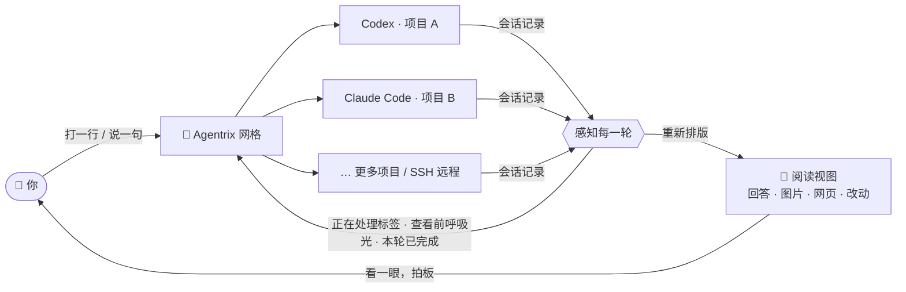
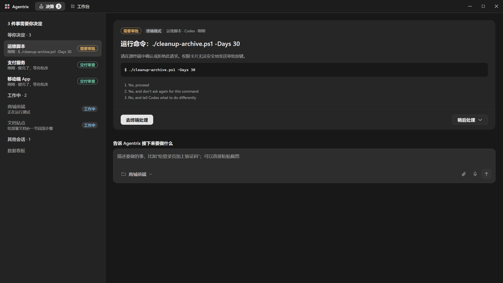
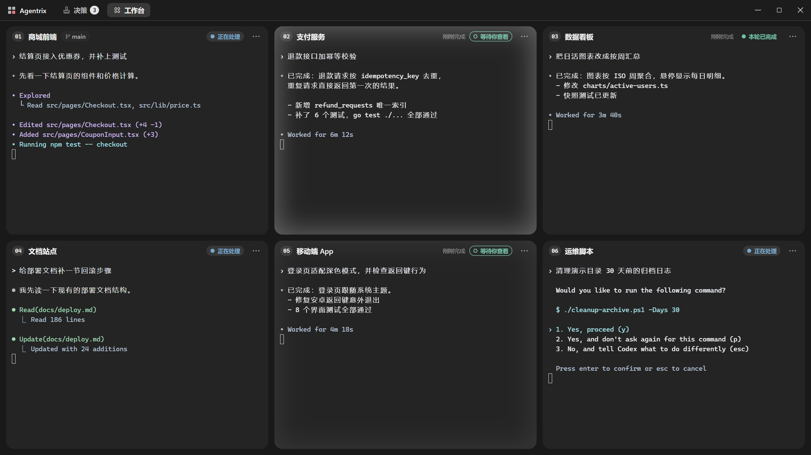
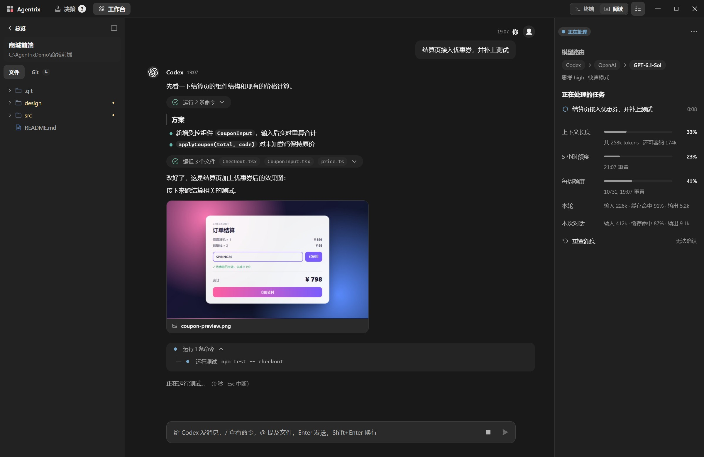
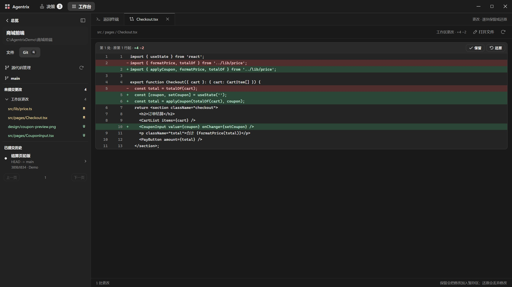
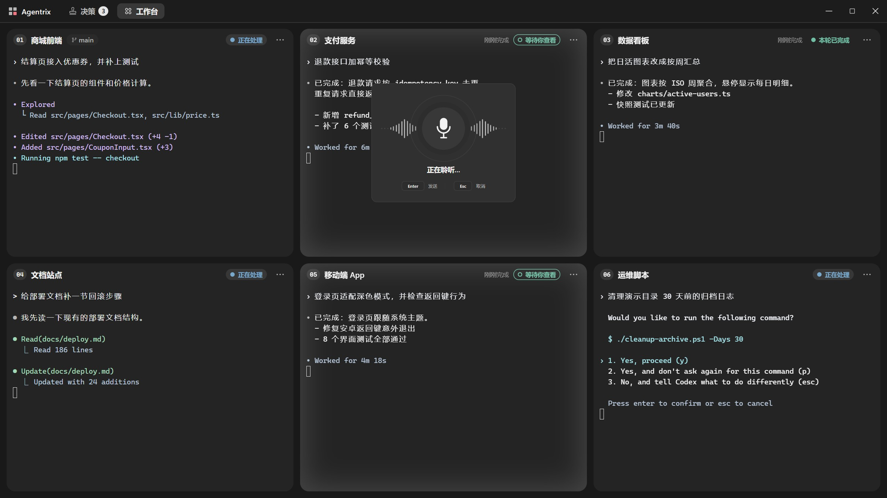

<p align="center">
  <a href="https://github.com/noeigenstate/Agentrix/releases/latest"></a>
</p>

<p align="center"><strong>从目标到交付的 AI 开发闭环：你说要什么，AI 去做，需要你决定时来找你，做完交给你验收。</strong></p>
<p align="center">Codex 和 Claude Code 同时开发多个项目；Agentrix 把需要你拍板的事集中到一处，把它们做出的东西摆到你面前。</p>

<p align="center">
  <a href="https://github.com/noeigenstate/Agentrix/releases/latest"></a>
  <a href="https://github.com/noeigenstate/Agentrix/releases"></a>
  
  <a href="LICENSE"></a>
</p>

<p align="center">
  <a href="https://github.com/noeigenstate/Agentrix/releases/latest"><strong>⬇️ 下载</strong></a> ·
  <a href="#-一眼看懂">一眼看懂</a> ·
  <a href="#-工作方式">工作方式</a> ·
  <a href="#-亮点">亮点</a> ·
  <a href="#-开始使用">开始使用</a> ·
  <a href="README.md">English</a>
</p>

<p align="center">
  
</p>
<p align="center"><sub>30 秒宣传片 · <a href="docs/images/promo.mp4">高清版</a></sub></p>

## ✨ 一眼看懂

<table>
  <tr>
    <td width="33%" valign="top"><h3>🧭 先决定</h3>审批、提问、选择、登录、等你审查的交付集中到一页。从终端画面识别的权限卡片打开源终端处理；支持的提问和选择可在卡片内作答。</td>
    <td width="33%" valign="top"><h3>🧩 一屏多开</h3>网格卡片显示 Codex 和 Claude Code 会话。标题栏的「正在处理」和圆点表示工作中，向内呼吸的光表示做完等你看；每条指令只提醒一次。</td>
    <td width="33%" valign="top"><h3>📖 直接读对话</h3>居中的聊天栏里，你的消息在右，助手的回答在左，命令按组折叠；图片、网页、视频随回答显示。</td>
  </tr>
  <tr>
    <td valign="top"><h3>📊 用量一目了然</h3>活动栏显示主模型和子代理及其实时 token/s、上下文，以及自动更新的 5 小时和每周额度。「重置额度」先倒数 10 秒，随时可取消，再打开 Codex 的 <code>/usage</code>，由你在那里确认重置。</td>
    <td valign="top"><h3>✅ 逐块取舍</h3>按 Git 方式逐块看改动：留下想要的，还原其余的，不用记 <code>git add -p</code>。</td>
    <td valign="top"><h3>🎙️ 开口即指令</h3><kbd>Ctrl</kbd>+<kbd>T</kbd> 说话、回车发送。识别在本机离线完成，录音不上传。</td>
  </tr>
</table>

## 🔭 下一代编辑器

编辑器围着**文件和光标**设计了四十年。AI 写代码之后，真正要管理的是**任务和助手**：哪个在思考，哪个做完了，哪个卡住在等你，它到底改了什么。

Agentrix 不只是一个能开很多终端的窗口，而是一条完整的开发闭环——**提出目标 → AI 并行执行 → 需要你时集中决策 → 产物摆到面前 → 逐块取舍交付**。你管目标和判断，执行交给 AI。

| | 在 IDE 里开几个终端 | Agentrix |
| --- | --- | --- |
| **同时做几个项目** | 来回切窗口，靠记忆 | 一张网格全摆开，状态一目了然 |
| **它做完了吗？** | 盯着终端等它安静 | 读会话记录判断，做完亮灯、通知 |
| **它说了什么** | 终端里的字符画 | 排版好的文档，图片和网页直接显示 |
| **它改了什么** | 自己跑 `git diff` | 逐块呈现，一键保留或还原 |
| **给它下指令** | 敲键盘 | 打字或者直接说 |

终端里跑的仍是你自己安装的 `codex` 和 `claude`，按键、配置和交互都不变。

## 🧠 工作方式



## 🚀 亮点

### 🧭 先决定，再进项目



Agentrix 默认打开**决策**首页。从会话列表选择项目；未选中决策时，居中的新任务输入框下方显示该会话最近一轮的简短摘要。输入目标、粘贴截图或语音输入，再按 Enter 开始。任务会发给已运行的助手，也可以先启动选中的本地助手；SSH 助手需要事先运行。摘要旁的「打开会话」进入该项目。顶栏的「决策 · 工作台」随时切换，工作台是项目网格。

选中决策后，可查看请求和来源。从终端画面识别的权限卡片打开终端审批；选择卡片确认所选答案，提问卡片按 CLI 的作答方式操作。也可以打开来源或暂缓处理，执行仍会等待。交付审查卡片展示本轮回答、文件和实际记录的检查：「通过」表示已查看这一轮，「打回并发送批语」把批语作为下一条指令发送。通过不会自动提交、合并或推送改动。

**原生审批（主动选择）：** 在新会话启动器中选择 **Native approvals**。Codex 保留真实 TUI，通过 Agentrix 自有、经过认证的本机 app-server 通道运行（远程传输仍为实验功能）。阅读视图和决策页直接展示该通道收到的请求，使用 CLI 原始、保留类型的 JSON-RPC 请求 ID 作答。命令与文件请求支持单次允许、拒绝或取消当前轮次；权限请求只授予 CLI 请求的原始权限且仅限当前轮次，或全部拒绝。不提供会话级授权或策略修改。

**Claude SDK (managed)** 是明确标注的托管会话：使用专用阅读输入框、结构化消息以及 CLI 发出的工具审批 ID。允许时原样返回工具输入，拒绝时拒绝该工具。此模式不提供交互式 TUI、斜杠菜单、图片附件或续接历史；已有权限设置和 hooks 仍由 CLI 执行，不注入无条件放行工具的 hook。普通 Claude TUI 仍可通过标准启动方式使用。

**其他会话仍只在终端里审批：** 普通终端、SSH、常规菜单与登录保持原有行为，从屏幕识别的权限卡只打开源终端。未知 Codex 请求交给真实 TUI；不支持的 Claude 控制请求会停止托管通道。原生模式只创建新会话，不自动恢复或重连。传输出错、流格式异常、ID 复用，或审批搁置超过 10 分钟，都会撤销待审批卡并关闭该会话；不自动重试，也不降级为 PTY 按键。原生传输不可用时可选择标准终端。

### 🧩 一屏指挥所有项目



工作台的小卡片只显示正在运行 Codex 或 Claude Code 的终端。普通 shell 照常运行，展开项目就能看到。没有助手时，本地卡片显示启动器，SSH 卡片显示空白启动区；已有 shell 运行时，点击 **N 个终端运行中 · 点击展开** 即可查看。

- ● **标题栏的「正在处理」和圆点**：工作仍在进行，卡片没有彩色状态边缘
- ⚪ **向内呼吸的光、系统通知**：本轮工作已完成，等你检查结果
- ✓ **不发光、无边缘**：已经看过，显示「本轮已完成」，随时下达下一条指令
- 🔴 **红色边缘**：出错了，查看终端输出

深色主题使用白色光，浅色主题使用深色光。光从边缘向内淡入，每次呼吸约 2.5 秒，直到查看，没有彩色完成边框。打开项目或在其终端发送新指令后，呼吸光熄灭。项目进入专注模式后不画状态边缘。

状态读自 Codex 和 Claude Code 记录的会话轮次：必须等主轮次、已跟踪的后台子代理与命令、排队消息和项目内其他活跃助手终端的工作全部结束，卡片才提醒。持续运行的服务与监听程序不计为待完成工作。单个步骤结束不算。没有新指令，同一轮不会再次提醒。

按住标题栏拖动卡片排序。点击标题栏、等待状态或明确的展开入口，在当前窗口内放大项目；F11 单独控制系统全屏。在小卡片的终端里输入、选择和复制文字，都不会放大卡片。缩回项目后，会话和未发送的草稿保留；同一个项目可以开多个终端分屏。

### 📖 终端，被重新排版



展开项目后，在标题栏用 **终端 | 阅读** 把 Claude Code 或 Codex 的对话切换成**阅读视图**：聊天栏居中，左右留白一致，你的消息在右，助手的回答在左。你的头像和 Claude、Codex 的官方标志（启动器里也用同样的标志）铺满时间轴节点，不带装饰性的彩色圆环。回答支持标题、列表、表格和带「复制」按钮的代码块。命令与工具调用按组折叠，显示摘要和改动的文件名。最新完成的一轮在成果上方显示状态；代码成果展示实际运行的检查，不再单列改动文件。下方提供相关操作：打开文件、查看或保存图片、复制回答、继续修改或重试。SSH 项目不能在这里保存生成图片；只有助手可以接收新指令时才能重试。底部输入框发给同一个会话，粘贴进去的每张图片都有自己的移除按钮。

- **产物就在回答里。** 助手写出或提到的受支持图片、网页、视频、Markdown 随回答显示；普通单击在当前界面弹窗预览，Esc 关闭。生成图片的提示词默认显示两行摘要，可以展开全文。
- **定位路径。** 在阅读视图里，按住 Ctrl 点击本地文件路径（macOS 使用 Command+点击），在系统文件管理器中选中文件；目录则直接打开。相对路径以项目根目录为准；已存在的绝对路径可以位于项目外。路径不存在时会提示错误；SSH 路径无法在本机定位。普通链接和预览仍在应用内打开受支持的文件。
- **在弹窗里直接操作 CLI。** 发送斜杠命令或 `!` Shell 命令，会在阅读视图上弹出同一个实时终端。Esc 等按键交给 CLI；点关闭按钮或弹窗外面返回阅读，CLI 中的对话框保持原状。输入 `/` 列出全部命令，`@` 提及项目文件；本地 `/resume` 仍打开会话列表。
- **提问和确认变成卡片。** 权限提示展示为信息卡片并提供打开终端入口；`/model` 之类的选择，以及 Claude Code（AskUserQuestion）和 Codex（Plan 模式）向你提的问题，继续使用交互卡片；它正在做什么也像 CLI 一样写在对话末尾，带计时和「Esc 中断」。
- **干活时也能接着说。** 它工作时发的消息标成「已送达，排队中」，当前这一步做完它就会读到，不会重复发送，也不会被当成没送达。Claude 额度恢复后的自动续跑提示不显示成你的排队消息。

右侧**活动栏**先显示**主模型**：最近一条回复实际用的模型、接口、思考强度和速度模式、平均输出速率（token/s），以及主轮次的任务（一行，带经过时间和此刻正在做的步骤，后面是排队的任务，一轮结束后显示为「本轮已完成」；由后台结果触发的轮次显示该结果）。再按子代理实际运行的模型分组显示调用，每组标「子代理」并有自己的 token/s；速率是已完成回复的输出 token 除以这些回复所用时间，每条回复结束就更新，读不到记录时（如 SSH 项目）显示「— token/s」。例如 Sonnet 5.5 子代理、Codex 的 GPT-6.1-Sol 子任务；命令行工作者来自 Agentrix 启动助手的声明，并由工作者自己报告的模型、思考强度和模式确认（Claude Code 自己的 Agent 调用则来自它的记录），不再靠解析命令行去猜。每次调用用紧凑单行显示，标明「准备中」「运行中」「审核中」或「已完成」；失败直接写成文字（「未能启动」「模型满载」「已停止」「出错退出（代码 N）」）；审核轮结束后移除，已完成的命令行工作者约 3 秒后移除。主模型里的任务和调用的模型分别在自己的区域滚动。下方依次是对齐的上下文长度、5 小时额度和每周额度进度条，再是各占一行的**本轮**与**本次对话** token 明细：输入、缓存命中和输出，没有「用量」标题或 token 总数列。额度自动取最新的 Codex 记录；Claude 终端运行时 Agentrix 直接查询 Claude 账号额度（最多每分钟一次，不往终端输入任何内容），查询不到时用 Claude Code 缓存的 `/usage` 或更新的 CodePulse 记录；已知重置时间也会显示。

Codex 的**重置额度**行在同一行显示剩余次数或查询状态。点击后，窗口中央出现大的 10 秒倒计时；点「取消」、按 Esc 或点击空白处都能取消。倒数归零才打开 Codex 自己的 `/usage`，在里面选择要用的重置并确认。Agentrix 自己从不调用重置。支持的本地官方 Codex 账号通过独立的只读 app-server 查询剩余重置次数。本地封装器检查完整启动参数，支持无额外参数、`resume`、`-m`/`--model`，以及仅修改 `model`、`model_reasoning_effort`、`service_tier`（含快速模式）的 `-c`/`--config`；profile、账号/接口覆盖、相关环境变量或 home 变更无法证明安全时明确显示不可查询。未知、查询失败和不支持会明确区分，不会当成 0。远程、自定义接口及无法确认启动环境的会话不借用本机账号的次数。

> 阅读视图目前支持 **Claude Code** 和 **Codex**。OpenCode、Gemini CLI 等其他命令行助手照常在展开项目后的终端里运行。

### ✅ 逐块取舍



一轮做完，在 Git 栏点开改动的文件，按 `git diff` 的方式逐块显示。**每一块单独决定**：保留就加入暂存区，不要就还原；已暂存的可以取消，删掉的文件能找回。

### 🧰 技能：每个会话都照你的做法来

技能是一个带 `SKILL.md` 的文件夹，写明你希望助手怎么做事。在 **设置 → 技能** 里，左边是技能列表，右边是选中技能的详情。Agentrix 启动的每个 Claude Code 和 Codex 会话，都会在启动说明里收到这些技能；SSH 会话收到的是只读副本。

- **系统自带，随应用更新，只读。** *模型路由* 按角色分工：主会话统筹，Opus 做规划并审查架构，GPT-6.1-Sol 写核心代码，Sonnet 做常规功能和前端，GPT-6.1-Terra 验收界面。GPT 默认 max + fast，Claude 默认 high；装了 Codex 时每个项目问一次，之后随时可以在对话里改。同时装了两个助手、只装 Claude Code、只装 Codex、由 Codex 主导，各有对应方案。*代码规范* 在你第一次打开项目时审查现有代码并给出分阶段计划，你同意前不改任何东西；之后每次代码改动都照它来。
- **我的技能。** 可以新建、编辑或导入文件夹，逐个开关，作用范围选所有项目或单个项目。技能保存在 Agentrix 的数据目录，或项目的 `skills/` 文件夹里。
- **三种触发。** *始终*（每个任务开始前）、*按需*（描述与任务匹配时）、*首次打开项目*（项目里还没有它时的第一个会话，之后按需）。
- **项目自己的优先。** 项目里有同名技能（在 `skills/`、`.claude/skills` 或 `.codex/skills` 中），或在 `AGENTS.md` / `CLAUDE.md` 里提到它时，系统自带的就让位。
- **越用越顺手。** 助手会随项目推进优化你的技能。每个版本都保留，可以对比差异、退回旧版。助手新建的技能带「新 · 由 Agent 创建」标记；关掉「允许 Agent 自动优化」就固定住它，打开「需要我确认后再生效」则每条修改都先等你审阅。用户名、个人目录、主机、邮箱和密钥等个人信息在写入项目技能前会换成占位符。
- **看得见它生效。** 「生效证据」显示助手最近一次读取这个技能的时间、项目和助手。`SKILL.md` 按排版后的文字显示，可切换「源码」。

### 🎙️ 开口即指令



在项目的 **⋯** 菜单中选择**语音输入**，对当前选中的终端分屏说话，也可按 <kbd>Ctrl</kbd>+<kbd>T</kbd>；回车发送。识别在本机离线完成，**录音不上传**，无需 API 密钥；可选「高精度 · 中英混合」模型。

在决策页的新任务框或审查批语框中，Enter 只插入识别出的文字，由你检查后再发送。

### 🔑 从安装到登录，都在窗口里

- **没装也能开始**：新项目卡片上会标出没装的助手，点一下一键安装，装好就启动；连 Node.js 都没有时会带你去下载。
- **第一次启动不卡住**：信任文件夹、选登录方式、更新提示都变成弹窗；登录时弹出「登录 Claude Code / Codex」窗口，一键在浏览器打开登录页、粘贴授权码或 API Key、复制一次性验证码。授权码只交给 CLI，不会出现在对话或任务列表里。

### 还有这些

- **重开即续上**：启动时恢复上次的终端和 Codex / Claude Code 会话，被打断的任务自动接着做。
- **SSH 远程项目**：沿用 VS Code Remote-SSH 的主机配置，终端、文件、Git、预览都走 SSH，局域网电脑上生成的网页和图片同样能预览。
- **文件就在手边**：紧凑的目录树，缓存文件变淡且可隐藏；自动保存的编辑器（VS Code 的编辑快捷键，<kbd>Ctrl</kbd>+<kbd>F</kbd> 查找），以及图片、网页、视频和 Markdown 预览。本地文件的右键菜单可打开其所在位置。在终端里，<kbd>Ctrl</kbd>+点击（macOS 使用 <kbd>⌘</kbd>+点击）受支持的项目文件链接，弹窗预览；HTTP/HTTPS 链接交给浏览器，识别出的本地目录链接交给文件管理器。SSH 文件预览限定在远程项目内，远程目录链接在应用内打开目录视图。文件不存在或格式不支持时会显示提示。放大的图片按窗口完整显示，单击看原始大小，拖动查看。
- **分屏随手拖**：同一个项目开多个终端分屏，没有上下栏。鼠标悬停或键盘焦点进入分屏时，右上角出现拖动柄、重启和关闭；按住拖动柄可调整顺序。
- **清晰的界面**：在「设置 → 外观」选择「黑底白字」（默认深色）或「白底黑字」（浅色）。两者都使用实色灰阶表面；字号、终端字体和字重仍可调整。
- **项目缩略图**：自动选取并固定本地项目图片，在 [外观设置](docs/project-images.md) 统一更换或恢复原有编号。
- **界面缩放**：在「设置 → 外观 → 界面缩放」选择 80%–150%，界面与文字（含终端）同比例缩放；默认「自动」，按当前显示器调整。
- **设置中的版本与更新**：「更新与关于」显示版本和分发形式（安装版、便携版、开发版、macOS 或 Linux），并按当前更新状态提供检查、重试、打开下载页或重启安装入口。「更新日志」（版本说明按条列出）和「关于」各有独立页面。标题栏使用应用的四方块标志和印章形的决策图标。
- **中英双语、快捷键可改、Windows 安装版支持更新**，第一次打开时会一步步带你上手。

## 📦 开始使用

新安装默认使用英语。在 **Settings → Appearance → Language（设置 → 外观 → 语言）** 中选择「中文」即可切换；已保存的语言偏好保持不变。

**需要：** Windows 10 / 11 x64，Apple 芯片的 Mac（macOS 12 或更高），或 64 位 Linux 桌面（x64 / arm64）。安装 [Codex CLI](https://github.com/openai/codex) 或 [Claude Code](https://docs.anthropic.com/claude-code)，并确保能从 PATH 找到。本地一键安装需要 Node.js 和 npm；缺少 npm 时会提供 Node.js 下载入口。提交任务前先登录助手。

1. **安装**：从 [Releases](https://github.com/noeigenstate/Agentrix/releases/latest) 下载对应平台的版本（见下）。
2. **添加项目**：按 <kbd>Ctrl</kbd>+<kbd>Shift</kbd>+<kbd>N</kbd> 选择项目文件夹，可以一次选多个，也可以添加 SSH 远程项目。
3. **下达指令**：在卡片上选 Claude Code 或 Codex，接着这个文件夹上次的对话或开始新开发；第一次用会弹窗带你登录。说出要做的事，然后去忙别的，完成状态的呼吸光亮起时回来看结果。

| 平台 | 下载 | 说明 |
| --- | --- | --- |
| **Windows x64** | `Agentrix-Setup-<version>-x64.exe` | 安装版检查并下载稳定版更新，下载完成后由你选择重启安装 |
| **macOS arm64** | `Agentrix-<version>-mac-arm64.dmg` / `Agentrix-<version>-mac-arm64.zip`，或下面的安装命令 | 临时签名，未经 Apple 公证；再次运行命令即可更新 |
| **Linux x64** | `Agentrix-<version>-linux-x86_64.AppImage` / `Agentrix-<version>-linux-x64.tar.xz` | 给 AppImage 添加执行权限，或解压后运行 `./agentrix`；手动更新 |
| **Linux arm64** | `Agentrix-<version>-linux-arm64.AppImage` / `Agentrix-<version>-linux-arm64.tar.xz` | 使用步骤与 Linux x64 相同；手动更新 |

Windows 便携目录和开发版不会自动更新；设置会识别分发形式并说明可用的更新方式。Windows 只发布安装程序，没有独立的便携版可执行文件。

```bash
curl -fsSL https://raw.githubusercontent.com/noeigenstate/Agentrix/main/scripts/install-macos.sh | bash
```

macOS 安装命令下载最新已发布版本的 ZIP，校验 SHA-256 后安装。从浏览器下载 DMG 后，首次打开可能需要在「系统设置 → 隐私与安全性」中选择「仍要打开」。

指定版本、手动安装、macOS 与 Linux 的终端和快捷键细节，见 [使用文档](docs/usage.md#安装细节)。

<details>
<summary><strong>⌨️ 常用快捷键</strong>（都可以在设置里改；macOS 同样使用 Control）</summary>

| 快捷键 | 功能 |
| --- | --- |
| <kbd>Ctrl</kbd>+<kbd>Shift</kbd>+<kbd>N</kbd> | 添加项目 |
| <kbd>Ctrl</kbd>+<kbd>Shift</kbd>+<kbd>Enter</kbd> | 放大或还原当前项目 |
| <kbd>Ctrl</kbd>+<kbd>Shift</kbd>+<kbd>G</kbd> | 返回总览 |
| <kbd>Ctrl</kbd>+<kbd>Shift</kbd>+<kbd>D</kbd> | 返回决策页 |
| <kbd>Ctrl</kbd>+<kbd>Shift</kbd>+<kbd>→</kbd> / <kbd>Ctrl</kbd>+<kbd>Shift</kbd>+<kbd>←</kbd> | 切换到网格右侧 / 左侧的项目，小卡片保持原尺寸 |
| <kbd>Ctrl</kbd>+<kbd>Shift</kbd>+<kbd>↑</kbd> / <kbd>Ctrl</kbd>+<kbd>Shift</kbd>+<kbd>↓</kbd> | 切换到网格上方 / 下方的项目，小卡片保持原尺寸 |
| <kbd>Ctrl</kbd>+<kbd>Shift</kbd>+<kbd>T</kbd> | 当前项目新建终端并分屏 |
| <kbd>Ctrl</kbd>+<kbd>Shift</kbd>+<kbd>W</kbd> | 移除当前项目（文件保留） |
| <kbd>Ctrl</kbd>+<kbd>T</kbd> | 语音输入；Enter 向终端发送，或向任务框、批语框插入文字；Esc 取消 |
| <kbd>Ctrl</kbd>+<kbd>Shift</kbd>+<kbd>F</kbd> | 在总览中搜索项目 |
| <kbd>Ctrl</kbd>+<kbd>B</kbd> | 在放大的项目中展开或收起目录栏 |
| <kbd>F11</kbd> | 切换系统窗口全屏 |
| <kbd>Ctrl</kbd>+<kbd>,</kbd> | 设置 |

</details>

## ❓ 常见问题

<details>
<summary><strong>我的代码和数据会被上传吗？</strong></summary>

Agentrix 本身**不收集任何数据，没有统计上报**。它通过 GitHub 检查更新，通过 Hugging Face 或其国内镜像下载离线语音识别模型，也可按需通过 npm 安装助手。Codex 和 Claude Code 与各自服务的通信，和你平时在终端里使用时一样。

</details>

<details>
<summary><strong>和在 IDE 里开几个终端有什么不同？</strong></summary>

终端还是那个终端，区别在于 Agentrix **知道每个 AI 助手处在什么状态**：它读取 Codex 和 Claude Code 的会话记录，准确判断这一轮是在处理、做完了还是被中断，并把回答、命令结果、图片网页和改动重新排版给你看。它是为「同时指挥多个 AI 任务」设计的，而不是为「一个人编辑一个文件」设计的。

</details>

<details>
<summary><strong>「重置额度」会自动帮我重置吗？</strong></summary>

不会。Codex 重置会用掉套餐里有限的次数，所以点击这一行后先倒数 10 秒，点「取消」、按 Esc 或点击空白处都能取消；倒数结束后也只是打开 Codex 的 `/usage`，在里面选择要用的重置并确认。Agentrix 不调用任何重置接口，也不会在你没点的时候发出这个命令。

</details>

<details>
<summary><strong>会改动我的 Codex / Claude Code 配置吗？</strong></summary>

不会。完成提醒用的钩子和「阅读视图能显示图片」的说明都在启动时临时传入，不写入你的配置文件，你自己的 hook、设置和指令照常生效，你在命令行里另外指定的同类参数优先。

</details>

## 🗺️ 路线图

- [ ] 在 Agentrix 里记住每个项目的快速模式和强度选择，模型路由不再重复询问
- [ ] 把 SSH 上做出的技能优化同步回你自己的技能
- [ ] 分享技能：先支持导出与导入，再做技能市场
- [ ] 更多系统自带技能
- [ ] 只读的需求面板：按需求和 Bug 列出状态与修复次数
- [ ] 开发概览：每个需求和 Bug 花了多少 token、多少钱、多少时间
- [ ] 更多 CLI 的阅读视图（OpenCode、Gemini CLI 等）
- [ ] WSL 工作区

有想法？欢迎提 [Issue](https://github.com/noeigenstate/Agentrix/issues)。觉得有用的话，点个 ⭐ Star。

## 🛠️ 参与开发

```bash
git clone https://github.com/noeigenstate/Agentrix.git
cd Agentrix
npm ci
npm start              # 开发运行
npm test               # 单元测试
npm run test:desktop   # 真实桌面交互测试
npm run dist           # 构建 Windows 安装版（macOS：dist:mac，Linux：dist:linux）
```

Electron · React · TypeScript · xterm.js · node-pty。发布工作流在发布前运行单元测试、打包版桌面检查和 Linux SSH 集成测试。截图由 `scripts/readme-shots.mjs` 从演示项目生成，宣传片由 `scripts/promo/` 逐帧渲染。

## 📄 许可证

[MIT](LICENSE)。

---

<p align="center">
  <strong>让 AI 去干活，让注意力回到需要你的地方。</strong><br />
  <a href="https://github.com/noeigenstate/Agentrix/releases/latest">下载体验</a> ·
  <a href="https://github.com/noeigenstate/Agentrix/issues">反馈与建议</a>
</p>
